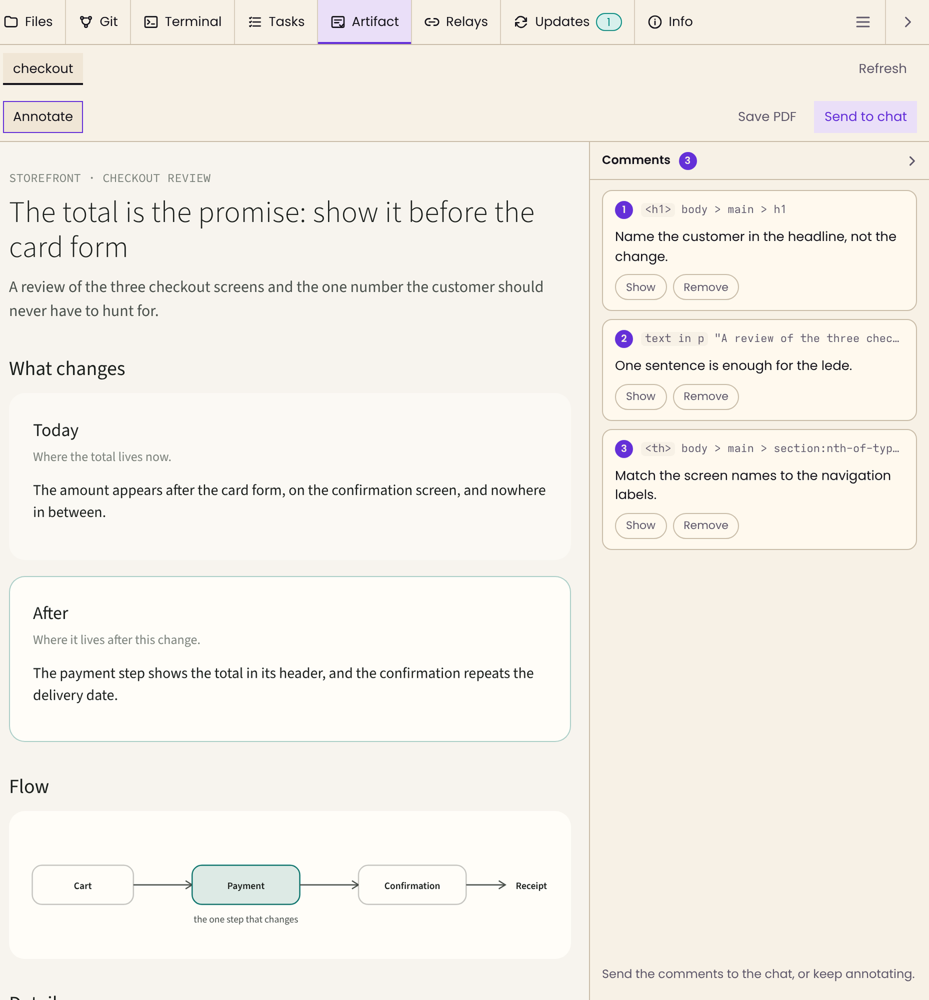
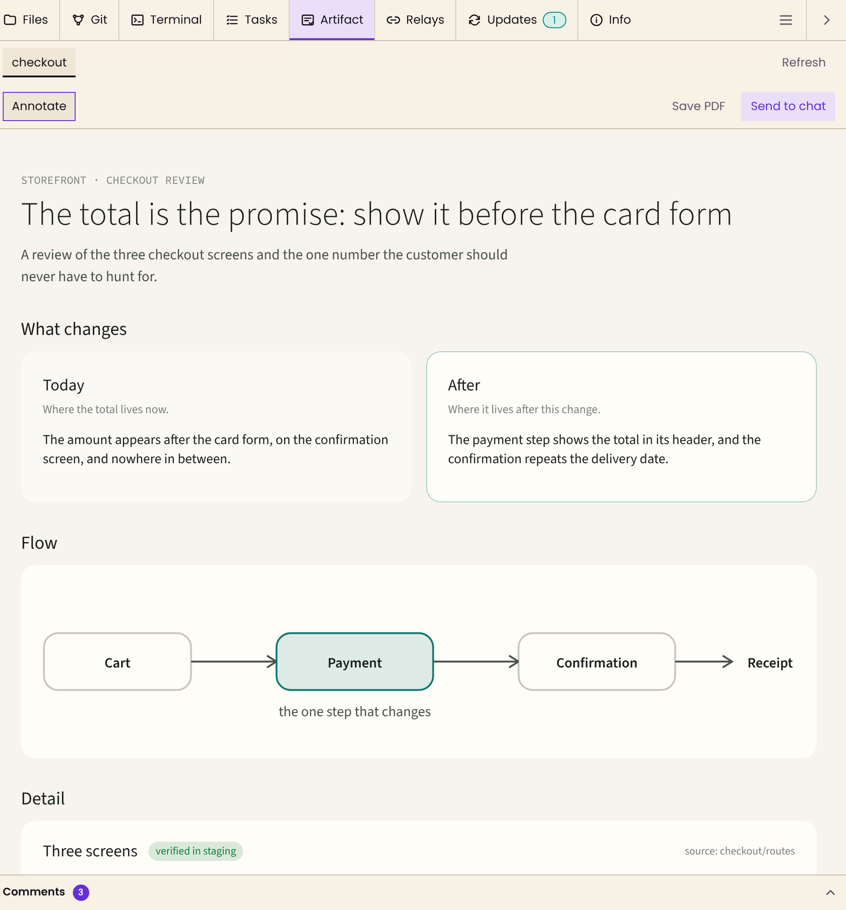
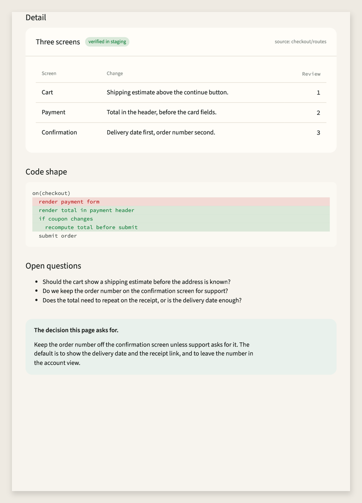

# Artifact

A PI WEB tab that renders an agent-written page in the workspace, lets you annotate elements and selected
text, and hands the comments to the conversation as a single message. It ships with the Pi skill that writes
those pages.



*The Artifact tab on a page the agent wrote. Each comment names the element or quotes the selection, and
**Send to chat** turns the list into one message.*

## Why it is good

- **The comment knows what it points at.** Every comment carries the target's tag and CSS selector, or the
  text it quotes, so the agent revises the thing you saw instead of a description of it.
- **The page uses the product's design.** The skill reads the repository's own colours, type and radii into
  the page, so a review of a checkout screen looks like the checkout, not like a generic report.
- **Review is one message, not a thread.** Comments are staged as one chip; the agent receives a numbered list
  of targets and requested changes, and you decide when to send it.
- **It keeps up without losing your place.** A revision lands in the same tab and keeps comments, an open
  draft and scroll. Fold the comments away to see the page at full width.
- **Nothing to operate.** It is a browser-only plugin: no server, no port, no daemon restart. The artifact runs
  in a sandbox at an opaque origin, and its policy blocks every network request.
- **It travels.** **Save PDF** takes the page to people outside PI WEB, and deep links take the selected page
  to the ones inside.

## How it works

```
Agent writes test-results/artifact/<session>/<topic>/artifact.html
        │
        ▼
Artifact tab renders it in a sandbox, on the page's own design tokens
        │  you click an element or select text, write a comment
        ▼
Send to chat stages one chip → the agent reads the comments and revises the page
```

## Requirements

PI WEB with browser API v5 and the `stylesheet-integration` v1 capability (verified on 1.202610.7). The plugin
declares that capability as required, so an older host skips it instead of rendering it unstyled. The skill
needs Node.js 18 or later for its token script and nothing else: no build step, no runtime dependencies.

## Install

PI WEB discovers PI WEB plugins from installed Pi packages, so one `pi install` registers both the tab and
`/skill:artifact`. There is no build step and no service restart.

```bash
pi install git:github.com/ivolejon/pi-web-artifact
```

Reload the browser page for the tab. A running Pi session needs `/reload`, or a new session, before the skill
appears. Pi reads the package declaration after project trust.

Check both:

```bash
curl -s http://127.0.0.1:8504/api/plugins | grep -o '"id":"artifact"[^}]*'   # the tab
pi list | grep artifact                                                      # the skill
```

The host port in the example is the one this package is developed against; use your own. The package itself
needs nothing beyond PI WEB and, for the skill, Node.js 18 or later.

### Local development

Clone the repository, link it as a local PI WEB plugin, and install the local package for the skill. The
local plugin wins over the package copy, so edits under `browser/` show up on the next page reload.

```bash
git clone https://github.com/ivolejon/pi-web-artifact.git
ln -sfn "$(pwd)/pi-web-artifact" ~/.pi-web/plugins/artifact
pi install -l ./pi-web-artifact
```

On a machine where `PI_WEB_DATA_DIR` is set, link into `$PI_WEB_DATA_DIR/plugins` instead.

### Update

```bash
pi update git:github.com/ivolejon/pi-web-artifact
```

Reload the browser page for the tab. A running Pi session needs `/reload` for the updated skill. No
session-daemon restart is needed, because the package has no server module. A symlinked development clone is
updated with `git pull`, then a page reload.

### Remove

```bash
pi remove git:github.com/ivolejon/pi-web-artifact
```

Reload the browser page. Settings → PI WEB plugins can also disable the tab without removing the package. If
you linked a development clone, delete that symlink.

## What it does

- **Binds to the open conversation.** It shows every `.html` file under
  `test-results/artifact/<session id>/` in the selected workspace as a tab, newest first, and shows nothing
  when no conversation is selected. The session segment is what keeps two conversations in one workspace
  apart.
- **Exposes one page at a time, per tab.** One strip, one tab per page, the topic name when it is unique and
  the file name when one topic holds several pages. Arrow keys, Home and End move between tabs, and a strip
  that scrolls fades at the edge that continues.
- **Renders in a sandbox.** An `iframe` with `sandbox="allow-scripts"` and no `allow-same-origin`, so the page
  runs at an opaque origin: it cannot read the host, its cookies or its DOM. A `Content-Security-Policy`
  blocks every network request. Relative stylesheets are read through the file API and inlined; local images
  are resolved through the host's preview URL, which is the only permitted network origin.
- **Follows the file.** A write from outside the app, such as the agent saving from a terminal, does not
  always raise a host invalidation, so the panel also compares the artifact's modification time every two
  seconds while the tab is visible. A changed file is re-read, and the user's comments, open comment field
  and scroll position are kept.
- **Opens itself.** When a new page appears for the open conversation, the tab selects itself within a couple
  of seconds, so the skill writes the page and says nothing. A revision of an existing page never steals the
  tab back, and loading the app never moves it.
- **Collects comments.** **Annotate** is one toggle: on, a click on an element or a text selection opens a
  comment field naming the target and its CSS selector; off, clicks stay inside the page as the page intends.
  Press **Enter** to add the comment. **Show** scrolls the artifact back to it, **Remove** deletes it.
  Comments are kept in `sessionStorage` per conversation and page, because the host unmounts the panel
  whenever another tab is selected.
- **Sends to the chat.** **Send to chat** stages the comments as a chip in the message box (`setChip`), or
  writes them into the box when the host has no chip support. You press **Send**; the plugin never posts a
  message on its own.
- **Deep links.** The panel stores the selected page in the tab's query, and a chat or Files link to a file
  under the open conversation's directory opens in this tab. A link to another conversation's artifact opens
  in Files instead.

## Folding the comments column



*Folded, the column becomes a strip that keeps the count; the artifact takes the full panel width. The choice
survives reloads, and a click in the page reopens the column with the comment field.*

The column's header is the toggle. It works in both layouts: beside the artifact on a wide panel, below it
when the panel is narrow. The strip keeps the comment count even when nothing is open, so the column is
always one click away.

## Save as PDF



*The second page of a **Save as PDF** export. The table, the diff and the note keep their layout, and the page
break falls between blocks rather than through one.*

**Save PDF** prints the artifact alone through the browser's own print pipeline, so the file keeps the page's
colours, fonts and selectable text and contains none of the review chrome. The browser has no API that writes
a PDF directly, so the print dialog's **Save as PDF** is the download step, and the suggested file name is the
topic. The print stylesheet keeps the background, switches entrance animations off, avoids splitting cards,
tables, code blocks and images across pages, and uses the page's own padding as the page margin.

## The skill

`skills/artifact` teaches the agent to build the page: what form to choose, how to take the colours and type
from the repository under review instead of inventing them, and what the comments come back as.

- `scripts/design-tokens.mjs` discovers the project's stylesheet, copies its custom properties and its local
  font files into `<run>/tokens.css`, and maps them onto the semantic names the structure sheet reads.
  Exit code 3 means it found no design source, and the neutral defaults carry the page.
- `assets/artifact.css` is the structure sheet: layout, cards, pills, tables, diffs, diagrams. It names no
  product colour.
- `assets/artifact-template.html` is the page skeleton to copy.

## Files

| File | Role |
| --- | --- |
| `package.json` | the `piWeb.plugins` entry that PI WEB discovers |
| `browser/` | the browser-public root: everything the host serves to the page |
| `browser/pi-web-plugin.js` | contributions: the Artifact tab, its action, file-open routing |
| `browser/review-panel.js` | the panel element: discovery, rendering, comments, chip staging |
| `browser/compose.js` | builds the sandboxed document, inlines local assets, injects the annotation script, and builds the print copy |
| `browser/auto-open.js` | selects the tab when a new page appears for the open conversation |
| `skills/artifact/` | the skill, its structure sheet, template and design-token script |
| `docs/images/` | the screenshots used by this README |
| `test/` | unit tests for the composer and browser tests for the panel, with their harness |
| `.github/workflows/test.yml` | runs the suite on every push to `main` and every pull request |

The package follows the plugin guide's layout. `browserRoot` is `browser`, so only that directory is
browser-public; `package.json`, this README and the skill files are served to nobody. The entry is
`browser/pi-web-plugin.js`, resolved from the package root, and the package has no server module, so
installing or updating it needs a page reload and never a session-daemon restart.

## Two host contracts, not APIs

The plugin guide asks plugins to use only public entrypoints, not internal routes. `auto-open.js` cannot obey
that and also work while its own tab is closed: a browser plugin gets no context and no navigation function
until its panel is rendered. It therefore relies on two things the API does not promise, both commented
where they are used. Check them after a PI WEB upgrade, and drop the module if either breaks:

1. A workspace label renders in every workspace view, so its callback is where the plugin captures its
   context. That context's file handle can point at another workspace, so the listing uses the host's
   `api/machines/<machine>/projects/<project>/workspaces/<workspace>/tree` route with the ids from the URL.
2. There is no API for selecting a tool from a closed panel, so the switch rewrites the `tool` and `view`
   URL parameters and dispatches `popstate`.

If either contract changes, the tab stops opening by itself. The panel and the comments keep working, and the
page stays one click away.

## Publishing

The intended npm package name is `pi-web-artifact`, unscoped and public. The community directory lists public
npm packages tagged `pi-web.dev-plugin`; there is no submission or registration step, so the keywords in
`package.json` are the whole listing.

```bash
npm login
npm test
npm publish --dry-run   # inspect the exact tarball
npm publish             # unscoped, public by default
```

`files` keeps the tarball to `browser/` and `skills/`; npm always adds `README.md`, `LICENSE` and
`package.json`. The README images load from GitHub, so the screenshots stay out of the installed package. The
directory also expects `pi-package`; both keywords are already declared.

For later releases, bump the version first, then publish:

```bash
npm version patch        # or minor / major
npm publish
pi update npm:pi-web-artifact
```

A browser-only release needs a page reload after the update. A running Pi session needs `/reload` for the
skill. npm search indexing can take a while before a new package or version appears in the community
directory.

## Tests

```bash
npm install
npx playwright install chromium   # once per machine; --with-deps on Linux CI
npm test
```

`test/compose.test.js` covers the composer without a browser: stylesheet inlining and escaping, missing and
remote sheets, image preview URLs and the policy, the annotation script, the print copy and its title, and the
comment text. `test/panel.browser.test.js` mounts the real `<artifact-panel>` against an in-memory workspace in
`test/support/harness.html`: tab order and selection, discovery and session binding, stylesheet rendering,
the comments fold and its persistence, element and text comments, chip staging, draft restoration, the print
document's shape and a real PDF from it, and the stacked layout. GitHub Actions runs both suites on every
push to `main` and every pull request.

The tests need Node.js 20 or later and Playwright's Chromium. Playwright is a devDependency, and `pi` installs
packages with production dependencies only, so people who use the plugin never install it.

## Verify a change

1. Reload the browser, open a conversation that has an artifact under
   `test-results/artifact/<that session id>/`, and open the Artifact tab.
2. Confirm the page renders with the project's own colours and fonts and no console errors, and that it fills
   the panel; narrow the window until the comments column moves below the frame. Fold the column and check
   that the strip keeps the comment count and that a reload keeps it folded.
3. Click a heading and a paragraph: both comments must name a selector, and the text comment must quote the
   selection.
4. Press **Save PDF**, choose **Save as PDF** in the print dialog, and open the file: the page appears alone,
   with its colours and selectable text, and a card or code block is not cut across pages.
5. Press **Send to chat** and confirm the chip appears in the message box. Do not press Send unless the
   conversation you are testing in should receive the comments.
6. Select another conversation and confirm the tab shows that conversation's state, with the previous
   conversation's comments gone. Select none and confirm the notice.

## License

MIT. See [LICENSE](LICENSE).
